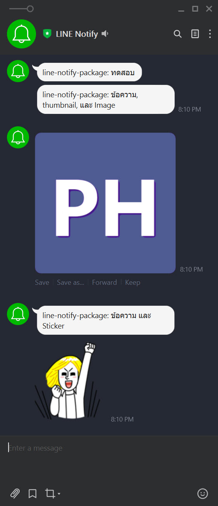

> [!CAUTION]
> **This package is abandoned.** LINE shut down the LINE Notify service on 31 March 2025, so this package can no longer send anything.
> To send LINE notifications from Laravel, push messages through the [LINE Messaging API](https://developers.line.biz/en/docs/messaging-api/overview/) of a LINE Official Account instead.
> A walkthrough in Thai: [ส่งแจ้งเตือนเข้า LINE จาก Laravel](https://phattarachai.dev/blog/line-notify-laravel-php).

**The package for Laravel and PHP for Line application notification.**

[](https://github.com/phattarachai/line-notify/releases)
[](https://github.com/phattarachai/line-notify/releases)
[](https://codeclimate.com/github/phattarachai/line-notify/maintainability)

Line Notify is a package for Laravel and PHP application to easily send notification to Line messaging application users
or groups. It builds on top of [Line Notify API](https://notify-bot.line.me/doc/en/), that provides a fluent interface
to send messages, images ,and stickers directly to Line service from Laravel and PHP.

# <a id="installing-line-notify"></a> Installing Line Notify

You need to use Composer to install Line-Notify into your project:

```
composer require phattarachai/line-notify
```

## Laravel Usage

Add a `LINE_ACCESS_TOKEN`  variable to your `.env`. You can get an access token for your application
from [Line Notify API](https://notify-bot.line.me/my/)

```env
// .env
LINE_ACCESS_TOKEN=#Token Go here#
```

Send a message via Line Notify.

```php
use Phattarachai\LineNotify\Facade\Line;

Line::send('message');
```

You can use setToken() to specify other ACCESS_TOKEN you want to use beside from the .env.

```php
use Phattarachai\LineNotify\Facade\Line;

Line::setToken(/*...access token */)
    ->send('message');
```

Send a message with an image.

```php
Line::imageUrl('https://lorempixel.com/1024/1024/')
    ->send('message');
```

You can also specify a thumbnail for your image

```php
Line::thumbnailUrl('https://lorempixel.com/240/240/')
    ->imageUrl('https://lorempixel.com/1024/1024/')
    ->send('message');
```

You can upload an image from your local path

```php
Line::imagePath('/path/to/your/image.png')
    ->send('message');
```

You can combine image uploading and image url together. The uploaded image will take precedence to image url.

```php
Line::thumbnailUrl('https://lorempixel.com/240/240/')
    ->imageUrl('https://lorempixel.com/1024/1024/')
    ->imagePath('/path/to/your/image.png')
    ->send('message');
```

Send a message with sticker. You can find a list of Sticker Package ID and Sticker ID
here https://devdocs.line.me/files/sticker_list.pdf

```php
Line::sticker(1, 138)
    ->send('message');
```

Notice that Line require to have a message for each and every request whether you send an image or sticker you still
required to provide a message for the API.

### <a name="config-publish"></a> Publishing the configuration file

Alternatively to adding a variable into your `.env`, you can publish `config/line-notify.php` file and add your token
there.

Run the following Artisan command in your terminal:

```
php artisan vendor:publish --provider="Phattarachai\LineNotify\LineNotifyServiceProvider"
```

You can set the token in this file.

```php
// File: /config/line-notify.php
return [
    'access_token' => env('LINE_ACCESS_TOKEN'),
];
```

## Configuring (Laravel)

### <a name="config-auto-discovery"></a> Laravel 5.5 and newer

Line Notify wil register itself using
Laravel's [Auto Discovery](https://laravel.com/docs/5.5/packages#package-discovery).

### <a name="config-service-loader"></a> Laravel 5.4 and older

You'll have to include `LineNotifyServiceProvider` in your `config/app.php`:

```php
'providers' => [
    /*
     * Package Service Providers...
     */
    Phattarachai\LineNotify\LineNotifyServiceProvider::class,
]
```

## PHP Usage (outside Laravel)

```php
use Phattarachai\LineNotify\Line;

$line = new Line('YOUR-API-TOKEN-HERE');
$line->send('message');
```

## Screenshot




## สนับสนุนผู้พัฒนา

🙋‍♂️ สวัสดีครับ ผมอ๊อฟนะครับ เป็น Full Stack Web Developer มีสร้าง package ขึ้นมาใช้งานในโปรเจคตัวเองที่ใช้งานบ่อย ๆ
ถ้ามีข้อเสนอแนะอยากให้ทำ package อะไรบน PHP / Laravel / NodeJS / Python หรือภาษาอื่น ๆ ทักทายมาได้เลยครับ

line:
[phat-chai](https://line.me/ti/p/~phat-chai)

💻 รับงาน Freelance หากมีโปรเจคที่น่าสนใจ หาทีมงานร่วมงาน หาโปรแกรมเมอร์ที่มีประสบการณ์ช่วยแก้โจทย์ที่ท้าทาย
ติดต่อมาได้เลยครับ ยินดีให้ความช่วยเหลือและรอสร้างผลงานที่ดีร่วมกันครับ

📄 เข้ามาดูประวัติและผลงานได้ที่ https://phattarachai.dev

<a href="https://phattarachai.dev">
    
</a>

## License

The MIT License (MIT)
